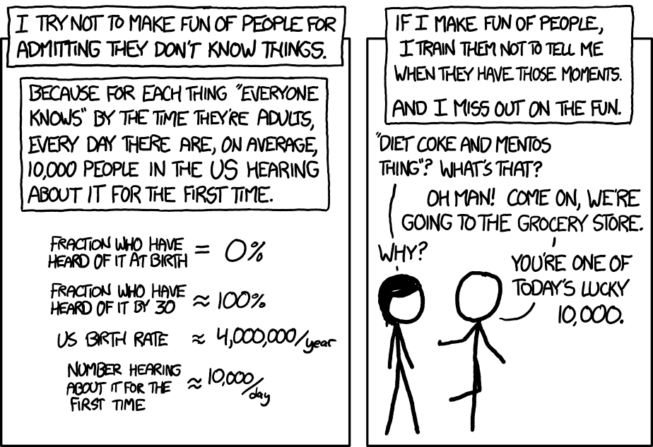

# 🐱 NikoCode — InfoSec Reference (Belajar Cepat)

**Kumpulan Referensi, Peta Jalan, dan Contekan Keamanan Siber (Cybersecurity) Terkurasi**

 

[🚀 Peta Belajar Cepat](#-peta-belajar-cepat-fast-track) · [⚡ Contekan Cepat](#-contekan--latihan-langsung) · [📚 Indeks Lengkap Topik](#-indeks-lengkap-semua-topik) · [🤝 Kontribusi](CONTRIBUTING.md)

---

> [!NOTE]
> **Keterangan Modifikasi (MIT License):** Berkas ini merupakan hasil lokalisasi dan penyusunan ulang ke Bahasa Indonesia dari repositori asli **[rmusser01/Infosec_Reference](https://github.com/rmusser01/Infosec_Reference)** (*Copyright (c) 2017 Robert Musser*, berlisensi [MIT License](LICENSE)). Seluruh tautan referensi, hak cipta asli, dan kredit pembuat tetap dipertahankan.

---

> [!IMPORTANT]
> **Etika & Keamanan Belajar:** Seluruh materi di repositori ini ditujukan **murni untuk edukasi, riset, dan pertahanan sistem**. Jangan pernah mempraktikkan teknik pengujian pada sistem atau jaringan tanpa izin resmi. Gunakan selalu **lab virtual pribadi** atau platform latihan legal (*CTF/Wargames*).

---

## 🎯 Tentang Repositori Ini

Repositori ini (diadaptasi dari proyek *InfoSec Reference* oleh [Robert Musser](https://twitter.com/r_o_b_e_r_t_1)) berfungsi seperti **"Buku Kuning" Keamanan Informasi** — berisi ribuan tautan terkurasi ke teknik, perkakas (*tools*), makalah riset, dan taktik di dunia *cybersecurity*.

Versi ini dirapikan khusus agar Anda bisa **belajar lebih cepat dan terarah** tanpa tersesat di lautan materi.

---

## 🚀 Peta Belajar Cepat (Fast-Track)

Ikuti urutan fase di bawah ini jika Anda ingin membangun pemahaman dari nol hingga mahir secara bertahap:

| Fase | Fokus Belajar | Materi Wajib |
| :--- | :--- | :--- |
| **1️⃣ Fondasi** | Pahami dasar sistem, jaringan, dan siapkan lab aman | • [Dasar Keamanan InfoSec](Draft/Basic.md) • [Membangun Lab Pengujian](Draft/Building_A_Lab.md) • [Serangan & Pertahanan Jaringan](Draft/Network_Attacks.md) • [Internals Sistem (Linux/Windows)](Draft/sysinternals.md) |
| **2️⃣ Praktik Dasar** | Mulai eksplorasi celah umum & asah logika | • [Keamanan Web (Web AppSec)](Draft/Web.md) • [OSINT (Riset Sumber Terbuka)](Draft/Osint.md) • [Keamanan Password](Draft/Passwords.md) • [Kriptografi & Enkripsi](Draft/CandE.md) |
| **3️⃣ Pilih Jalur** | Fokus pada spesialisasi karier yang Anda minati | **🔴 Red Team (Serangan):** [Red Teaming & Pentest](Draft/RT.md) · [Active Directory](Draft/Active_Directory.md) · [Privilege Escalation](Draft/PrivescPostEx.md) **🔵 Blue Team (Pertahanan):** [Pertahanan Sistem](Draft/Defense.md) · [Logging & Threat Hunting](Draft/L-SM-TH.md) · [Forensik & DFIR](Draft/DFIR.md) **⚙️ Low-Level & Malware:** [Reverse Engineering](Draft/RE.md) · [Analisis Malware](Draft/Malware.md) · [Exploit Dev](Draft/Exploit_Dev.md) |
| **4️⃣ Pendalaman** | Standar industri, otomasi, dan persiapan karier | • [Pemetaan MITRE ATT&CK](Draft/ATT%26CK-Stuff/README.md) • [Keamanan Cloud](Draft/Cloud.md) & [Containers](Draft/Containers.md) • [Dokumentasi & Pelaporan](Draft/Docs_and_Reports.md) • [Panduan Karier InfoSec](Draft/Career.md) |

---

## ⚡ Contekan & Latihan Langsung

Butuh referensi cepat saat praktik? Langsung buka halaman berikut:

| Kategori | Tautan Cepat | Kegunaan |
| :--- | :--- | :--- |
| **🛠️ Cheat Sheets** | [Kumpulan Contekan Cepat](Draft/Cheats.md) | Ringkasan perintah `Nmap`, `Metasploit`, `Radare2`, dll. |
| **🏴‍☠️ Latihan Legal** | [CTFs & Wargames](Draft/CTFs_Wargames.md) | Daftar platform latihan hacking legal & interaktif |
| **🎓 Kursus Gratis** | [Kursus & Pelatihan](Draft/Courses_Training.md) | Sumber belajar terstruktur (video, lab, sertifikasi) |
| **📝 Opini & Writeup** | [Rants & Writeups](Draft/Rants%26Writeups/README.md) | Studi kasus nyata dan tutorial lab langkah demi langkah |
| **🔒 Privasi & OpSec** | [Anonymity / OpSec / Privacy](Draft/AnonOpSecPrivacy.md) | Cara menjaga keamanan & privasi operasional pribadi |

---

## 📚 Indeks Lengkap Semua Topik

<b>Klik untuk membuka daftar lengkap seluruh 50+ topik referensi (A–Z & Kategori)</b>

<!-- nav:topics:start -->
### Reference topics

- [Pre-ATT&CK](Draft/ATT%26CK-Stuff/Pre-ATT%26CK/README.md)
- [ATT&CK Stuff](Draft/ATT%26CK-Stuff/ATT%26CK/README.md)
- [Attacking & Securing Active Directory](Draft/Active_Directory.md)
- [Anonymity/OpSec/Privacy](Draft/AnonOpSecPrivacy.md)
- [Basic Security Information](Draft/Basic.md)
- [BIOS/UEFI/Firmware Attacks/Defense](Draft/bios_uefi.md)
- [Building a Testing Lab](Draft/Building_A_Lab.md)
- [Car hacking](Draft/Cars.md)
- [Career](Draft/Career.md)
- [Cheat Sheets](Draft/Cheats.md)
- [Cloud](Draft/Cloud.md)
- [Conferences/Recordings](Draft/Conferences.md)
- [Containers](Draft/Containers.md)
- [Courses & Training](Draft/Courses_Training.md)
- [Cryptography & Encryption](Draft/CandE.md)
- [CTFs & Wargames](Draft/CTFs_Wargames.md)
- [Darknets](Draft/Darknets.md)
- [Data Analysis & Visualization](Draft/DataVis.md)
- [Defense](Draft/Defense.md)
- [Documentation & Reporting](Draft/Docs_and_Reports.md)
- [Embedded Device Security](Draft/Embedded.md)
- [Exfiltration](Draft/Exfiltration.md)
- [Exploit Development](Draft/Exploit_Dev.md)
- [Forensics & Incident Response](Draft/DFIR.md)
- [Fuzzing & Bug Hunting](Draft/Fuzzing.md)
- [Game Hacking](Draft/Games.md)
- [Honeypots](Draft/honeypot.md)
- [Interesting Things & Useful Information](Draft/Interesting_Things.md)
- [Logging, Monitoring, & Threat Hunting](Draft/L-SM-TH.md)
- [Malware](Draft/Malware.md)
- [Network Attacks & Defense](Draft/Network_Attacks.md)
- [Open Source Intelligence Gathering - OSINT](Draft/Osint.md)
- [Passwords](Draft/Passwords.md)
- [Phishing](Draft/Phishing.md)
- [Physical Security](Draft/Physical_Security.md)
- [Privilege Escalation and Post-Exploitation](Draft/PrivescPostEx.md)
- [Linux Privilege Escalation & Post-Exploitation](Draft/PrivescPostExLin.md)
- [macOS Privilege Escalation & Post-Exploitation](Draft/PrivescPostExmac.md)
- [Windows Privilege Escalation & Post-Exploitation](Draft/PrivEscPostExWin.md)
- [AppSec/Programming Stuff](Draft/Programming_Language_Security.md)
- [Rants & Writeups](Draft/Rants%26Writeups/README.md)
- [Red Teaming/Penetration Testing Stuff](Draft/RT.md)
- [REMATH Reverse Engineering](Draft/Reverse%20Engineering%20-%20REMath%20Literature.md)
- [Reverse Engineering](Draft/RE.md)
- [Rootkits](Draft/Rootkits.md)
- [Social Engineering](Draft/SE.md)
- [System Internals (Linux/Windows)](Draft/sysinternals.md)
- [Threat Modeling](Draft/threatmodel.md)
- [UI/UX Design](Draft/UX.md)
- [Web](Draft/Web.md)
- [Wireless Networks and RF Devices](Draft/Wireless.md)
- [Cryptography: Additional References](Draft/Crypto_Encrypt.md)
- [SCADA/Industrial Control Systems](Draft/SCADA.md)

- [Alphabetical subject index](Draft/Subject_Index.md)
<!-- nav:topics:end -->

---

## 📖 Panduan & Sumber Daya Tambahan

- **Panduan Proyek**: [Panduan Kontribusi](CONTRIBUTING.md) · [Pemeliharaan Navigasi](docs/navigation.md) · [Panduan Pengarsipan](docs/archiving.md)
- **Arsip & Inventaris**: [Referensi Terarsip (Wayback Machine)](docs/archives/README.md) · [Inventaris Sumber Daya Non-Teks](docs/inventories/README.md)
- **Dokumen Kebijakan & Standar Industri**:
  - [NIST Cyber Security Framework](https://www.nist.gov/cyberframework)
  - [PCI-DSS V3.2.1](https://www.pcisecuritystandards.org/documents/PCI_DSS_v3-2-1.pdf)
  - [Insurance Data Security Model Law](http://www.naic.org/documents/committees_ex_cybersecurity_tf_exposure_mod_draft_clean.pdf)

---

*“Beri seseorang seekor ikan, dia akan kenyang seharian. Ajari dia cara memancing, dia akan berdaya seumur hidup.”*

Versi HTML tersedia di **[rmusser.net/docs](https://rmusser.net/docs)** · Jika materi ini bermanfaat, pertimbangkan berdonasi ke **[Doctors Without Borders](https://donate.doctorswithoutborders.org/onetime.cfm)** atau **[Amnesty International](https://www.amnesty.org/en/donate/)**.

