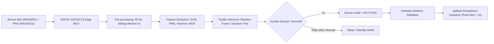

# Klaster 1: Arsitektur Sistem & Latar Belakang Gelang SOS Lansia & Disabilitas

## Ringkasan Eksekutif & Batasan Masalah Sistem
Proyek IoT Gelang Pintar Darurat ini dirancang untuk menjawab permasalahan kritis pada keselamatan populasi lanjut usia (lansia) dan penyandang disabilitas: **ketidakmampuan menekan tombol darurat fisik atau mengakses smartphone saat mengalami kejadian darurat (seperti jatuh tiba-tiba, serangan stroke/jantung, atau kelumpuhan sesaat)**.

## Spesifikasi Perangkat Keras
1. **Mikrokontroler Utama**: ESP32 / ESP32-C3 (Dual-Core 240MHz / RISC-V 160MHz, 520KB SRAM, 4MB Flash).
2. **Sensor Gerak & Inersial**: MPU6050 (3-axis accelerometer $\pm 2g - \pm 16g$, 3-axis gyroscope, 16-bit ADC via I2C).
3. **Sensor Fisiologis**: MAX30102 Optical Pulse Oximeter (Red & IR LED, denyut nadi BPM, saturasi oksigen SpO2).
4. **Indikator Feedback Lokal**: Active Buzzer 3.3V dan Haptic Vibration Motor.
5. **Catu Daya**: Baterai Li-Po 3.7V 500mAh dengan modul charger TP4056 dan regulator LDO 3.3V (AMS1117 / ME6211).

## Matriks Literatur Rujukan (Klaster 1)
| No | Judul Paper & Penulis | Tahun & Venue | Temuan Kunci | Relevansi Skripsi |
| :--- | :--- | :--- | :--- | :--- |
| 1 | **AI-Driven Wearable Technology for Routine Monitoring in Elderly with Dementia** Carvalho, M. | 2026 CiencIPCA | Integrasi sensor inersial dan fisiologis wearable untuk mengenali anomali. Akurasi 98%, False Alarm Rate 2.9%. | **Bab 1 & Bab 2**: Urgensi pemantauan pasif tanpa bergantung pada tombol manual. |
| 2 | **Technology-Assisted Home Support of Community-Dwelling Older Adults Living with Dementia** Moreno et al. | 2024 Gerontechnology | 88% lansia kesulitan mengoperasikan tombol fisik saat panik; membutuhkan deteksi otomatis. | **Bab 1**: Landasan latar belakang masalah dan justifikasi form-factor gelang tangan. |
| 3 | **A Review of Rescue Methods After Intelligent Rescue Equipment Approaches a Drowning Person** Pan et al. | 2026 Pomorstvo | Evaluasi multi-sensor fusion dan human-computer interaction darurat. | **Bab 2**: Landasan teoritis interaksi darurat manusia-mesin. |
| 4 | **Systematic Literature Review untuk Identifikasi Penggunaan Sensor dalam Deteksi Rasa Sakit** Giawa et al. | 2025 Jurnal Algoritma | Kombinasi biometrik PPG/EDA dengan akselerometer memberikan indeks distress objektif pada pasien non-verbal. | **Bab 1 & Bab 3**: Justifikasi penggunaan sensor ganda (IMU + PPG). |
| 5 | **Fine-Grained Human Activity Recognition in Smart Homes Through PPG-Based Hand Gesture Detection** Doukaga et al. | 2024 ACM PETRA | Akurasi pengenalan gestur mencapai 94.0% menggunakan kombinasi fitur optik dan inersial pergelangan tangan. | **Bab 2 & Bab 3**: Pembuktian bahwa sensor optik pergelangan tangan memperkuat akurasi gestur. |
