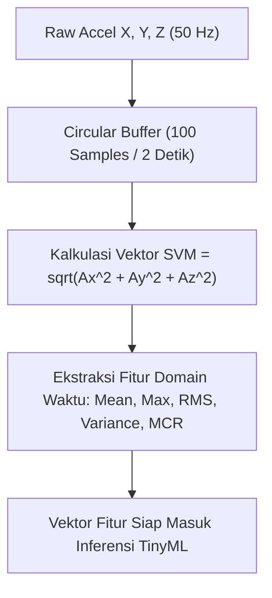

# Klaster 3: Ekstraksi Fitur, Sliding Window, & Reduksi False Alarm (ADL)

## Pemrosesan Sinyal: Sampling 50 Hz & Sliding Window 2 Detik
Data kinetik dari sensor akselerometer (MPU6050) disampling pada frekuensi **50 Hz** (1 data setiap 20 ms). Panjang jendela (*window size*) ditetapkan **2 detik** (100 sampel) dengan pergeseran geser (*overlap*) **50%** (50 sampel / 1 detik).

## Rumus Ekstraksi Fitur Domain Waktu

### 1. Signal Vector Magnitude (SVM)
Menyatukan percepatan 3-axis menjadi besaran skalar independen orientasi:
$$SVM_i = \sqrt{a_{x,i}^2 + a_{y,i}^2 + a_{z,i}^2}$$

Dalam kondisi diam normal, $SVM \approx 1.0g$. Saat terjadi hentakan jatuh bebas (*free fall*), $SVM$ turun drastis mendekati $0g$, diikuti lonjakan dampak (*impact peak*) hingga $> 2.5g - 4.0g$.

### 2. Root Mean Square (RMS)
Mengukur energi dinamis sinyal selama window 2 detik:
$$RMS = \sqrt{\frac{1}{N} \sum_{i=1}^{N} SVM_i^2}$$

### 3. Varians & Deviasi Standar (Variance)
Mengukur variasi goyangan pergelangan tangan:
$$Var = \frac{1}{N} \sum_{i=1}^{N} (SVM_i - \mu)^2$$

### 4. Mean Crossing Rate (MCR)
Frekuensi sinyal memotong nilai rata-rata, membedakan osilasi periodik (berjalan/berlari) dari hentakan tunggal (jatuh).

## Reduksi False Alarm dari Aktivitas Harian (ADL)
Aktivitas Harian Penjebak (*False Alarm Traps*):
- Bertepuk tangan (hentakan cepat tapi durasi sangat singkat < 100 ms).
- Meletakkan cangkir atau membenturkan tangan ke meja.
- Berjalan tergesa-gesa atau menuruni tangga.
- Mengayunkan tangan saat mengetik atau meraih benda.

Strategi Reduksi:
1. **Analisis Fase Pasca-Dampak (*Post-Impact Inactivity*)**: Setelah hentakan impact peak, sistem memantau kestabilan orientasi selama 1.5 - 2 detik. Jika subjek tetap tidak bergerak (lying still), kemungkinan darurat/jatuh > 95%.
2. **Threshold Bertingkat**: Menggabungkan ambang batas dinamis SVM dengan durasi henti.

## Matriks Literatur Rujukan (Klaster 3)
| No | Judul Paper & Penulis | Tahun & Venue | Temuan Kunci | Relevansi Skripsi |
| :--- | :--- | :--- | :--- | :--- |
| 1 | **A Novel Feature Extraction Method for Wearable Fall Detection Systems** Casilari et al. | 2022 Sensors MDPI | Window 2 detik dengan overlap 50% memberikan trade-off terbaik antara latensi respon dan akurasi ekstraksi fitur. | **Bab 3**: Justifikasi pemilihan panjang sliding window dan frekuensi sampling 50Hz. |
| 2 | **A Feature-Level Fusion Framework for Human Activity Recognition and Fall Detection** Wang et al. | 2025 IEEE TIM | Kombinasi fitur SVM, RMS, dan variansi akselerasi menurunkan false alarm rate pada ADL hingga di bawah 3.2%. | **Bab 3**: Landasan formulasi matematis fitur statistik yang digunakan. |
| 3 | **Event-Driven Signal Processing for Ultra-Low Power Wearable Devices** Santos et al. | 2021 IEEE TBME | Arsitektur circular buffer berbasis interupsi perangkat keras menghemat konsumsi daya ESP32 hingga 42%. | **Bab 3 & Bab 4**: Teknik implementasi circular buffer hemat energi. |
