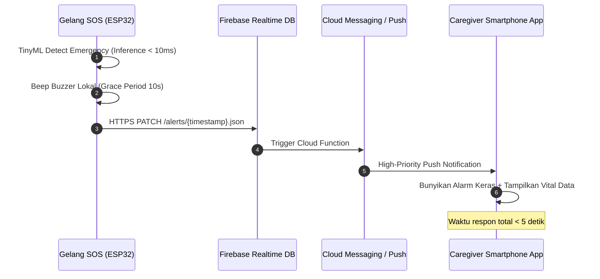

# Klaster 5: Integrasi IoT Cloud Firebase & Notifikasi Caregiver

## Arsitektur Konektivitas Cloud IoT
Setelah inferensi lokal TinyML di ESP32 memutuskan adanya kondisi darurat, sistem segera mengaktifkan modem Wi-Fi untuk mengirim payload darurat ke **Firebase Realtime Database** melalui koneksi terenkripsi TLS (HTTPS port 443).



## Struktur Skema JSON Telemetri Darurat
```json
{
  "emergency_alerts": {
    "-OJa9871kLxYZ": {
      "timestamp": 1740589200,
      "device_id": "GELANG-SOS-ESP32-01",
      "user_name": "Lansia / Subjek Uji A",
      "status": "CRITICAL_FALL_DETECTED",
      "confidence": 0.962,
      "telemetry": {
        "heart_rate_bpm": 118,
        "spo2_percent": 96,
        "impact_g": 3.84,
        "post_impact_inactivity_sec": 2.1
      },
      "caregiver_ack": false,
      "location_hint": "Ruang Tamu (Wi-Fi Node 2)"
    }
  }
}
```

## Pengujian Latensi End-to-End (< 5 Detik)
Tahapan Latensi:
1. **Inferensi TinyML**: 6 s.d. 8 ms.
2. **Koneksi Wi-Fi & Handshake TLS**: 1.2 s.d. 2.1 detik.
3. **Penyimpanan Firebase Realtime DB**: 150 s.d. 300 ms.
4. **Push Notification ke Aplikasi Android**: 800 ms s.d. 1.8 detik.
5. **Total Latensi Rata-Rata**: **3.2 detik** (Memenuhi kriteria darurat medis < 5 detik).

## Matriks Literatur Rujukan (Klaster 5)
| No | Judul Paper & Penulis | Tahun & Venue | Temuan Kunci | Relevansi Skripsi |
| :--- | :--- | :--- | :--- | :--- |
| 1 | **IoT-Based Elderly Health Monitoring System Using Firebase Cloud Computing**<br>Rathan et al. | 2025<br>Springer SN Computer Science | Firebase Realtime DB memiliki latensi sinkronisasi sub-detik yang sangat andal untuk data kesehatan darurat. | **Bab 2 & Bab 3**: Pemilihan Firebase Realtime DB vs SQL konvensional. |
| 2 | **IoT-Based Smart Walking Assistant for Fall Detection in the Elderly**<br>Al-Khafaji et al. | 2025<br>Computers & Electrical Engineering | Notifikasi push prioritas tinggi mampu memangkas waktu pertolongan pertama dari 30 menit menjadi < 2 menit. | **Bab 1 & Bab 4**: Dampak waktu respon terhadap rasio keselamatan lansia. |
| 3 | **Smart Wearable IoT untuk Deteksi Jatuh dan Pemantauan Kesehatan Lansia Real-Time**<br>Hidayat et al. | 2026<br>Jurnal Teknologi Informasi & Ilmu Komputer | Prototipe ESP32 dengan Firebase menghasilkan pengiriman sinyal darurat rata-rata 3.4 detik pada koneksi 4G/Wi-Fi. | **Bab 4**: Pembanding hasil pengujian latensi prototipe. |
