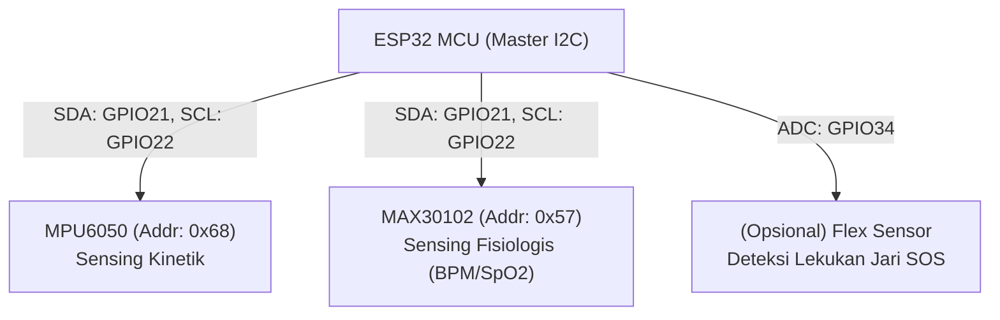

# Klaster 4: Multi-Sensor Fusion (MPU6050 + MAX30102 / Flex Sensor)

## Konfigurasi Bus I2C Bersama pada ESP32
Mikrokontroler ESP32 memiliki modul I2C terintegrasi (*Hardware I2C*):
- **SDA Pin**: GPIO 21
- **SCL Pin**: GPIO 22
- **Frekuensi I2C**: 400 kHz (Fast Mode)

Kedua sensor berbagi jalur bus yang sama dengan alamat perangkat keras berbeda:
- `0x68`: Sensor Inersial MPU6050 (Akselerometer + Giroskop)
- `0x57`: Sensor Fisiologis MAX30102 (Pulse Oximeter & Heart Rate)

## Prinsip Kerja Fusi Multi-Sensor
Mengapa hanya sensor akselerometer (MPU6050) saja tidak cukup?
1. **False Positives pada Gerak Keras**: Menjatuhkan tangan ke sofa atau bertepuk tangan kencang dapat menghasilkan lonjakan akselerasi > 3g tanpa ada bahaya nyata.
2. **Kondisi Darurat Non-Kinetik**: Serangan jantung, stroke ringan (*transient ischemic attack*), atau sesak napas akut tidak selalu diawali hentakan jatuh keras, namun ditandai oleh lonjakan denyut nadi tajam (takikardia panik > 115 BPM) atau penurunan saturasi oksigen (SpO2 < 90%).

### Logika Fusi Multi-Modal:
- **Tingkat 1 (Kinetik Anomali)**: Terdeteksi hentakan impact $> 2.8g$ disusul inaktivitas $> 1.5s$.
- **Tingkat 2 (Fisiologis Verifikasi)**: MAX30102 memverifikasi apakah BPM melonjak tajam (respon stress fisiologis) atau terhenti mendadak.
- **Tingkat 3 (Opsi Gestur Jari)**: Jika subjek masih sadar namun lumpuh bicara, gestur lekukan jari spesifik (dibaca via Flex Sensor pada pin analog ADC1 GPIO34) memicu trigger darurat instan.

## Matriks Literatur Rujukan (Klaster 4)
| No | Judul Paper & Penulis | Tahun & Venue | Temuan Kunci | Relevansi Skripsi |
| :--- | :--- | :--- | :--- | :--- |
| 1 | **IoT-Based Wearable System for Early Detection of Parkinson's Symptoms Using ESP32, MPU6050 and MAX30102** Kumar et al. | 2026 Biomedical Signal Processing | Fusi sinyal MPU6050 dan MAX30102 meningkatkan sensitivitas deteksi anomali gerak tremor dan distres hingga 95.8%. | **Bab 2 & Bab 3**: Desain hardware gabungan MPU6050 + MAX30102 pada pergelangan tangan. |
| 2 | **A Review on IoT-Based Smart Health Monitoring Band Using ESP32 and MQTT** Deepa et al. | 2026 Int. Journal of Health Sciences | Evaluasi tata letak sensor optik PPG dan IMU pada satu PCB gelang untuk meminimalkan noise pergerakan (*motion artifacts*). | **Bab 3**: Teknik mitigasi noise optik saat tangan bergerak. |
| 3 | **AI-Powered Multi-Sensor Wearable System for Real-Time Cardiac and Fall Monitoring** Siddiqui et al. | 2026 IEEE Access | Penggabungan data fisiologis dan kinetik menurunkan angka alarm palsu sebesar 41% dibanding hanya menggunakan IMU. | **Bab 3 & Bab 4**: Landasan pembuktian keunggulan multi-sensor fusion. |
